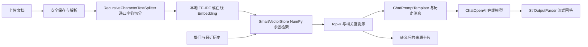

# SmartDoc-RAG 智能文档问答应用

基于 LangChain LCEL、Streamlit 与 OpenAI 兼容在线模型的课程项目。上传 PDF、DOCX、Markdown 或 TXT 文档后，应用完成解析、递归字符切分、本地检索或在线 Embedding 检索、模型生成，并展示来源片段供核对。

- 课程：《开源软件构建技术》第七章 智能应用开发。
- 开源仓库：[Zhoubin601/SmartDoc-RAG](https://github.com/Zhoubin601/SmartDoc-RAG)。
- 许可：[MIT](LICENSE)。当前不支持离线大语言模型；生成环节需要在线 API。

## 安装与启动

运行环境要求 **Python 3.10+**（已保存的测试记录在 Windows、Python 3.13.5 环境执行）。先创建虚拟环境并安装依赖，以下命令适用于 Windows PowerShell。

```powershell
git clone https://github.com/Zhoubin601/SmartDoc-RAG.git
cd SmartDoc-RAG/Code
python -m venv .venv
.venv\Scripts\Activate.ps1
python -m pip install -r requirements.txt
Copy-Item .env.example .env
# 编辑 .env 填入自己的 Key 后启动
python -m streamlit run app.py
```

Linux/macOS 激活虚拟环境使用 `source .venv/bin/activate`，复制配置使用 `cp .env.example .env`。在浏览器打开终端提供的本地地址，默认端口 8501。

可在 `Code/.env`、项目根目录 `.env`、进程环境变量或页面侧边栏配置。环境变量优先于 `.env`，存在 `Code/.env` 时优先加载它。Key 输入框使用密码模式；不要把真实凭据写入代码、截图或提交。

```dotenv
OPENAI_API_KEY=replace-with-your-own-key
OPENAI_BASE_URL=https://api.deepseek.com
MODEL_NAME=deepseek-flash
TEMPERATURE=0.3

# 仅选择在线 Embedding 时填写；必须使用支持独立 Embedding 的服务
EMBEDDING_API_KEY=
EMBEDDING_BASE_URL=
EMBEDDING_MODEL_NAME=text-embedding-3-small

CHUNK_SIZE=600
CHUNK_OVERLAP=100
TOP_K=4
```

配置示例使用 `deepseek-flash`，`OPENAI_BASE_URL` 填写 `https://api.deepseek.com` 或 `.env.example` 默认的 `https://api.deepseek.com/v1` 均可正常调用 DeepSeek 官方兼容接口；实际调用记录见[真实 API 测试报告](output/LIVE_API_TEST_REPORT.md)。模型工厂对 DeepSeek 官方接口的 `deepseek-flash` 和 `deepseek-v4-pro` 默认关闭 thinking，代码调用时可通过 `extra_body` 覆盖；其他服务不注入该参数。部分模型会忽略 Temperature，具体配置应以所用服务的[官方文档](https://api-docs.deepseek.com/)为准。

## 核心功能与模块实现

| 功能模块 | 当前代码实现 |
|---|---|
| 多格式文档上传 | 支持 PDF、DOCX、Markdown（`.md`/`.markdown`）、TXT 批量上传；使用 UUID 内部文件名排他保存，保留原始文件名用于展示与溯源，拒绝路径穿越、控制字符、不支持的扩展名与 0 字节空文件 |
| 文档解析与切分 | `pypdf` 提取 PDF 文字层并记录页码，`python-docx` 提取 DOCX 正文段落，多编码读取 TXT/Markdown；逐文件报告解析结果，通过 `RecursiveCharacterTextSplitter` 递归字符切分（默认 `chunk_size=600`、`chunk_overlap=100`） |
| 向量检索与 Top-K | `SmartVectorStore` 基于 NumPy 归一化向量点积计算余弦相似度并返回 Top-K（默认 `top_k=4`）；支持默认本地 TF-IDF 字符 2–3 gram 检索与可选在线 Embedding 检索 |
| RAG 问答与流式输出 | 基于 LangChain LCEL（`ChatPromptTemplate \| ChatOpenAI \| StrOutputParser`）构建问答链，调用在线大模型支持同步问答与 SSE 流式打字机输出 |
| 多轮对话指代 | `convert_chat_history` 保留最近 6 条有效 `user`/`assistant` 消息传入提示词，并在代词追问时融合上一轮用户提问执行检索 |
| 来源引用与转义 | 折叠面板展示实际传入模型上下文的参考片段、文件名、页码与检索相关度分数；所有外部字段经 `html.escape` 转义后渲染 |
| 无相关资料拒答 | 两级相关性守卫：最高分 `< 0.08` 时不传入低相关片段，直接注入无相关资料拒答提示且不显示未采用来源；`0.08 <= 最高分 < 0.15` 时注入低相关度甄别预警 |
| 知识库保存与恢复 | 快照保存 JSON 文档、NumPy 矩阵、模型身份元数据与 JSON TF-IDF 状态，`CURRENT` 指针原子切换；支持启动后按原配置恢复及 `add_documents()` 增量添加 |
| API 异常处理 | 捕获 401 鉴权失败、429 限流、超时与连接异常并分类提示；`mask_secret` 脱敏 API Key 与 Bearer 凭据，建库失败保留原知识库，流式异常自动回滚未完成提问 |

## 使用方法

1. 填写 Chat API Key、Base URL 和模型名称，选择检索模式。
2. 上传文档，点击“解析并构建向量知识库”。批量上传逐个报告失败原因；只使用成功解析的文件建库。
3. 输入问题，查看流式回答及引用卡片。可用“它的超时时间是多少”追问，最多向模型提供最近 6 条有效用户/助手消息。
4. 重启后点击“载入已保存的本地知识库”，选择与建库时相同的 Embedding 类型、模型及端点。恢复本身不调用在线 Embedding。

上传文件使用随机内部名排他保存，原名称用于展示及溯源，同名文件可同时存在。扩展名在保存前检查，路径名、盘符、控制字符和空文件会被拒绝。文件内容由对应解析器验证。界面支持 `.pdf`、`.docx`、`.md`、`.markdown`、`.txt`。

“构建”会创建新知识库；核心 `add_documents()` 接口支持增量添加，本地 TF-IDF 会用全部文档重新拟合，在线向量则检查维度后追加。新知识库完整保存成功才替换当前会话状态，失败保留已有知识库。“清空”仅清空当前会话和对话，磁盘快照仍可恢复；不会删除用户文件。

## 检索方式与限制

| 模式 | 实现及用途 | 配置和失败行为 |
|---|---|---|
| 默认本地 TF-IDF | scikit-learn 字符 2–3 gram，最多 2048 个特征；基于字面重合，不是深度语义 Embedding | 无需 Embedding Key；文档与查询使用同一词表和 IDF |
| 可选在线 Embedding | OpenAI 兼容独立 Embedding API，文档与查询使用相同模型/端点 | 缺 Key、不支持的 DeepSeek 官方地址、初始化或请求失败均明确报错，不自动回退 |

侧边栏显示**当前知识库实际使用的模式**。修改选项不会改变已有向量的空间；若选项与当前索引不同，页面明确提示，重新构建成功才切换。在线知识库继续使用建库时的 Embedding 实例；更新该服务凭据后需重新建库或重启后按原模型恢复。

检索使用归一化向量的余弦相似度 Top-K。最高分低于 **0.08** 时向模型提供无相关资料提示，最高分达到 **0.08** 但低于 **0.15** 时提供低相关预警。来源卡片与真正提供给模型的片段一致，未采用的零相关片段不会当作引用。

这些机制可以降低编造风险，不能彻底消除幻觉。检索得分不是回答正确概率；尤其 TF-IDF 对完全换词的提问召回有限。相关度较高也不保证资料包含答案，应核对原文。历史消息只帮助理解问题，不作为独立事实依据。

## 架构



LCEL 链是 `ChatPromptTemplate | 当前 LLM | StrOutputParser`。检索由 `RAGEngine` 先执行；`SmartVectorStore` 和 `SmartRetriever` 分别继承 LangChain 的 `VectorStore` 与 `BaseRetriever`。字符切分器按段落、换行、中文标点和字符边界递归切分，不调用语义 Embedding 来决定分块。

## 知识库保存与兼容性

知识库在 `Code/data/vector_db/snapshots/<快照标识>/` 保存 `docs.json`、`vectors.npy`、`metadata.json` 及本地模式的 `tfidf_state.json`。`CURRENT` 指向有效快照。候选快照写入并校验成功后原子切换指针，失败不改变原有有效快照。保留历史快照会占用磁盘，当前未提供自动清理功能。

加载时检查文档数量、矩阵行数/维度、有限数值、文件 SHA-256、Embedding 类型/模型/端点，以及 TF-IDF 词表、IDF、拟合状态与维度。哈希用于检测文件不一致，不是对来源真实性的认证。`numpy.load` 禁用 pickle，TF-IDF 状态以 JSON 保存。缺少可校验状态文件的知识库需要重新上传文档构建，已有文件不会被删除。

## 目录

```text
Code/
  app.py                 Streamlit 入口
  config.py              环境配置
  requirements.txt       运行及测试依赖
  .env.example           不含真实密钥的配置示例
  README.md              Code 目录快速运行说明
  LICENSE                MIT 许可证副本
  src/
    document_loader.py   多格式解析与字符切分
    uploads.py           安全保存与来源名称映射
    ui_helpers.py        来源 HTML 转义
    models.py            Chat/Embedding 工厂、脱敏、TF-IDF 状态
    vector_store.py      检索、增量、快照持久化
    rag_engine.py        LCEL、有限历史、相关度与来源
  tests/                 默认禁止真实 HTTP 的 pytest 测试
    benchmark/           固定评测夹具、离线与真实 API 脚本
  data/                  被 Git 忽略的运行时文件
raw/                     原始课程资料，只读保留
docs/                    分析、测试与验证记录
output/                  课程说明文档与 API 测试报告
memory-bank/             长期背景
design-system/           界面样式设计参考说明
LICENSE                  仓库根目录 MIT 许可证
README.md                项目技术说明主文档
```

## 测试和真实 API 验证

在 `Code/` 下执行：

```powershell
# 普通测试禁止真实 HTTP，不消耗 API Token
python -m pytest tests -v

# 默认只验证离线检索和提示词，生成结果标记 NOT TESTED
python tests/benchmark/run_eval.py

# 显式真实联调：最多 8 次 HTTP，含一次无效 Key 负例，重试关闭
# OPENAI_API_KEY 已通过环境变量配置
python tests/benchmark/run_live_api.py --live --evidence ../docs/live-evidence-new.json

# 可选：既有 10 题真实评测（额外最多 10 次 Chat 请求）
python tests/benchmark/run_eval.py --live --report ../docs/benchmark-new.md
```

真实联调可用 `--base-url`、`--model` 指定配置；默认 DeepSeek Flash、输出上限 256、超时 45 秒、重试为 0、本地 TF-IDF。脚本向所选 API 发送测试文档与问题，会产生费用；报告文件不允许覆盖，复测需换新路径。线上请求与 pytest 分开执行。`live_manual.md` 中站点及数值是明确标注的虚构测试数据，不是项目实际配置。

已保存的 [pytest 执行记录](docs/20261101-pytest-final.xml)显示，94 项测试通过，0 项失败，0 项跳过；真实模型调用与流式界面验证见[真实 API 测试报告](output/LIVE_API_TEST_REPORT.md)。现有[基准报告](Code/tests/benchmark/BENCHMARK_REPORT.md)仅供查阅对应样例，不能替代当前实现的验证。小型单文档测试不代表普遍准确率或性能。

## 已知边界与排错

- PDF 需要文字层；扫描件需自行 OCR。受密码保护的 PDF、损坏文件、无文本内容会报错。
- DOCX 当前读取正文段落，不支持表格文字、图片 OCR 或可靠的 Word 原始页码；DOCX/TXT/Markdown 的 `page=1` 是文本位置标签。
- 在线 Embedding 尚无真实服务调用记录；现有错误处理与兼容性测试使用 Mock。保存的真实问答测试采用本地 TF-IDF 检索和在线模型生成。
- 鉴权失败检查 Key；429 检查频率/余额；连接或超时检查网络和 URL。普通 UI 错误做凭据脱敏。
- 本应用是本地课程演示程序，没有多用户鉴权与租户隔离；不同浏览器会话可能共享磁盘目录，不宜直接作为多人公网服务。
- 未进行 WCAG AA 合规评估、压力测试或跨平台完整矩阵验证；不提供无测试依据的速度、准确率或无障碍认证承诺。
- 课程提交用说明文件：[Markdown](output/SmartDoc-RAG智能应用说明.md) · [Word](output/SmartDoc-RAG智能应用说明.docx)。
