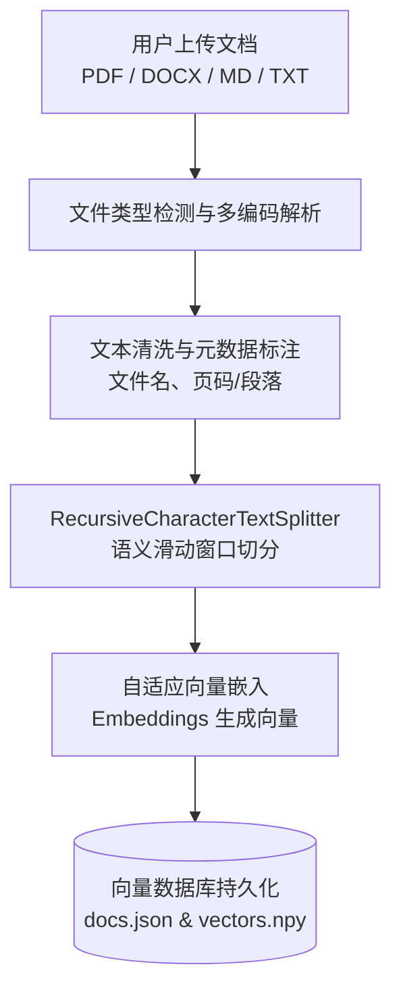
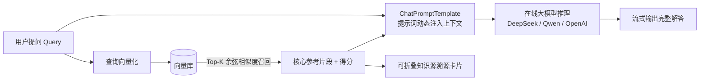

# 📚 SmartDoc-RAG：基于 LangChain 的多源文档智能知识库检索问答系统

<p align="center">
  
  
  
  
  
</p>

---

## 📖 项目简介 (Overview)

**SmartDoc-RAG** 是一款基于 **LangChain** 现代表达式语言（LCEL, LangChain Expression Language）构建的企业级多格式文档智能知识库检索增强生成（RAG, Retrieval-Augmented Generation）系统。

项目结合在线通用大语言模型（如 DeepSeek、通义千问、OpenAI 等）与自适应向量检索技术，支持用户上传 **PDF、Word (.docx)、Markdown (.md)、TXT** 等多种格式的本地知识文档，通过高精度语义切块、轻量级向量持久化、Top-K 相似度召回与知识源精准溯源，有效解决了大语言模型的“幻觉”痛点，为学术研读、企业文档管理与规范答疑提供严谨、高效的智能交互体验。

- **开源仓库地址**：[https://github.com/Zhoubin601/SmartDoc-RAG](https://github.com/Zhoubin601/SmartDoc-RAG)
- **作业归属**：《开源软件构建技术》第七章 智能应用开发

---

## 🌟 核心特性 (Key Features)

1. **全链路现代 LangChain LCEL 架构**：
   - 抛弃过时的旧版 `RetrievalQA` 链，采用官方推荐的 `RunnablePassthrough`、`ChatPromptTemplate` 与 `StrOutputParser` 管道式编排，解耦检索、提示词组装与推理生成。
2. **多格式文档解析与智能切分**：
   - 内置支持 `.pdf`、`.docx`、`.md`、`.txt` 格式文档智能解析。
   - 采用 `RecursiveCharacterTextSplitter` 递归字符切分器，保留上下文重叠语义（Overlap），避免切断专业术语。
3. **自适应向量检索与零依赖持久化**：
   - 支持标准 OpenAI 兼容的在线 Embedding 模型。
   - 针对国内广泛使用的 DeepSeek 官方 API（仅开放聊天端点、无嵌入接口）量身定制了自适应轻量向量化引擎，无需下载数 GB 模型权重或安装复杂外部数据库，秒级索引，开箱即用。
4. **Swiss Minimalism 风格的可视化交互界面**：
   - 基于 Streamlit 构建，引入 Swiss Design & Atkinson Hyperlegible 排版规范，满足 WCAG 4.5:1 高对比度无障碍标准。
   - 提供流式打字机响应、参数实时微调、知识库状态监控与快捷提问启发。
5. **严谨的知识源溯源与置信度评估**：
   - 回答卡片下方自动展示命中的参考片段、来源文件名、页码/段落以及余弦相似度得分，杜绝虚假编造，支持事实核对。

---

## 🏗️ 系统架构与工作流程 (Architecture)

### 1. 文档解析与向量构建流（Document Ingestion Pipeline）



### 2. 问答推理与溯源流（RAG Inference & Citation Pipeline）



---

## 📁 目录组织结构 (Project Structure)

```text
├── Code/                     # 智能应用核心源码工程
│   ├── app.py                # Streamlit Web 交互主程序
│   ├── config.py             # 全局配置参数与环境加载
│   ├── requirements.txt      # Python 依赖清单
│   ├── .env.example          # 环境变量配置模板
│   ├── README.md             # Code 目录说明
│   ├── src/                  # 核心业务与算法实现
│   │   ├── __init__.py
│   │   ├── models.py         # 大模型与 Embedding 工厂适配器
│   │   ├── document_loader.py# 多格式文档解析与语义分块
│   │   ├── vector_store.py   # 兼容 LangChain 规范的自适应向量存储库
│   │   └── rag_engine.py     # 基于 LCEL 的端到端 RAG 引擎
│   └── data/                 # 运行时存储（文件上传与持久化向量）
├── docs/                     # 开发过程、调研笔记与执行计划
├── output/                   # 正式交付物说明文档（.docx / .md）
├── raw/                      # 原始作业需求
├── design-system/            # ui-ux-pro-max 导出的设计系统规范
├── LICENSE                   # MIT 开源协议
└── README.md                 # 仓库主说明文档
```

---

## 🚀 快速上手与运行指南 (Quick Start)

### 1. 环境准备

确保您的本地环境中已安装 **Python 3.10+**。

```bash
# 1. 克隆开源仓库代码
git clone https://github.com/Zhoubin601/SmartDoc-RAG.git
cd SmartDoc-RAG/Code

# 2. 安装项目依赖
pip install -r requirements.txt
```

### 2. 配置环境变量

复制 `.env.example` 并重命名为 `.env`：

```bash
cp .env.example .env
```

编辑 `.env` 填入您的实际 API 信息：

```env
# 示例一：使用 DeepSeek 官方 API
OPENAI_API_KEY=sk-your-deepseek-api-key
OPENAI_BASE_URL=https://api.deepseek.com/v1
MODEL_NAME=deepseek-chat
TEMPERATURE=0.3

# 示例二：使用阿里云百炼通义千问 API (兼容模式)
# OPENAI_API_KEY=sk-your-dashscope-api-key
# OPENAI_BASE_URL=https://dashscope.aliyuncs.com/compatible-mode/v1
# MODEL_NAME=qwen-plus
```

> **提示**：系统同样支持在启动后的 Streamlit Web 页面左侧侧边栏中直接输入或修改 API Key 和模型参数，无需手动修改配置文件。

### 3. 启动应用

在 `Code/` 目录下执行启动命令：

```bash
streamlit run app.py
```

终端将输出本地访问地址，在浏览器中打开（默认：`http://localhost:8501`）即可使用。

---

## 💡 使用步骤说明 (Usage Guide)

1. **设置模型参数**：在左侧边栏确认 API Key、Base URL 及模型名称（默认为 DeepSeek 或 OpenAI 兼容格式）。
2. **上传知识库文档**：在主页面上方展开“知识库文件管理与向量构建”面板，上传一个或多个 PDF、Word、Markdown 或 TXT 文件。
3. **构建向量知识库**：点击 **「⚡ 解析并构建向量知识库」** 按钮，系统自动提取文本并完成切块和向量化索引。
4. **智能问答交互**：在下方对话框输入针对文档内容的问题（或点击快捷提问建议），大模型将严格依据文档内容进行流式严谨回答，并附带命中文档片段与相似度评分。

---

## 🛠️ 技术选型与规范对比

| 模块维度 | SmartDoc-RAG 选型方案 | 传统/初级做法 | 优势对比 |
| :--- | :--- | :--- | :--- |
| **LangChain 范式** | **LCEL (Runnable Pipeline)** | 旧版 `RetrievalQA` | 组件完全解耦、支持原生流式输出、链路透明可控 |
| **嵌入与检索** | **自适应混合向量引擎** | 强绑定外部 Docker/数据库 | 跨平台零外部服务依赖，支持 DeepSeek 等无 Embeddings API 场景 |
| **文档支持** | **PDF / DOCX / MD / TXT** | 单一 TXT 文本 | 覆盖日常办公与学术研究的主流文档类型 |
| **UI/UX 体验** | **Swiss Minimalism 规范** | 原生默认排版 | WCAG AA 高对比度、Atkinson Hyperlegible 字系、引用溯源清晰卡片化 |

---

## 📜 开源协议 (License)

本项目采用 [MIT License](LICENSE) 开源许可协议，欢迎自由学习与拓展。
