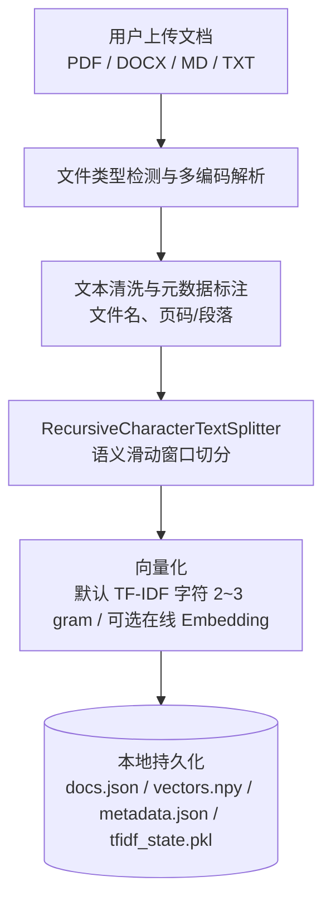
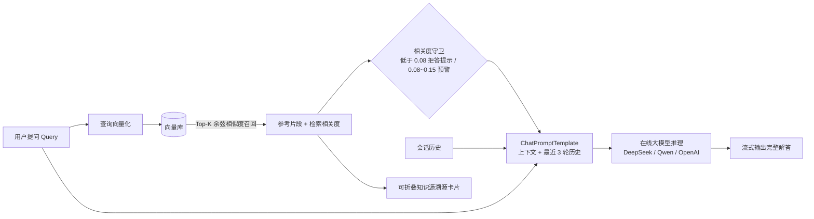

# 📚 SmartDoc-RAG：基于 LangChain 的多源文档智能知识库检索问答系统

<p align="center">
  
  
  
  
  
</p>

---

## 📖 项目简介 (Overview)

**SmartDoc-RAG** 是一个基于 **LangChain** 表达式语言（LCEL, LangChain Expression Language）构建的多格式文档检索增强生成（RAG, Retrieval-Augmented Generation）问答应用。

项目结合 OpenAI 兼容接口的在线大语言模型（如 DeepSeek、通义千问、OpenAI 等）与本地轻量检索，支持上传 **PDF、Word (.docx)、Markdown (.md)、TXT** 文档，完成解析、切分、向量化、Top-K 检索、提示词组装与流式生成，并在回答下方展示来源片段，便于用户核对答案依据。系统通过“仅依据参考资料作答 + 低相关度拒答提示”**降低**模型凭空编造的风险，但不能保证完全消除幻觉。

- **开源仓库地址**：[https://github.com/Zhoubin601/SmartDoc-RAG](https://github.com/Zhoubin601/SmartDoc-RAG)
- **作业归属**：《开源软件构建技术》第七章 智能应用开发

---

## 🌟 核心特性 (Key Features)

1. **LangChain LCEL 问答链**：
   - 使用 `ChatPromptTemplate`（含 `MessagesPlaceholder` 历史槽位）`| ChatOpenAI | StrOutputParser` 组成 LCEL 管道，支持 `invoke` 与 `stream`；检索步骤由 `RAGEngine` 先行执行并把格式化后的上下文注入提示词。
   - 自定义 `SmartVectorStore` / `SmartRetriever` 分别继承 LangChain `VectorStore` 与 `BaseRetriever` 接口。
2. **多格式文档解析与切分**：
   - 支持 `.pdf`、`.docx`、`.md`、`.txt`；对空文件、无文本层 PDF、加密/损坏文件、不支持的扩展名给出明确提示，批量上传时逐个列出失败文件与原因。
   - 采用 `RecursiveCharacterTextSplitter` 按段落、换行、中文标点递归切分，保留重叠窗口。
3. **两种向量化方式**：
   - **默认：本地 TF-IDF 字符 2~3 gram**（`scikit-learn`，2048 维）。这是**轻量字面相似度检索**，不是深度语义 Embedding；无需额外 API，适合 DeepSeek 等不提供 Embedding 接口的场景。
   - **可选：OpenAI 兼容在线 Embedding**。调用失败时抛出脱敏后的明确错误，**不会**静默切换到与已建索引不兼容的向量空间。
4. **知识库持久化与恢复**：
   - 保存 `docs.json`、`vectors.npy`、`metadata.json` 与 `tfidf_state.pkl`（TF-IDF 词表与 IDF 权重）；恢复时校验文档数、向量行数与特征维度，不一致则报错。侧边栏提供“载入已保存的本地知识库”按钮。
5. **有限轮数多轮对话**：
   - 最近 3 轮（6 条）历史注入提示词，仅用于理解“它/该/上述”等指代；提示词明确要求事实依据仍以检索到的文档为准。含代词的追问会拼接上一轮用户问题进行检索。
6. **来源溯源与无答案处理**：
   - 回答下方展示来源文件名、页码与**检索相关度（余弦相似度）**；该分数只反映切片与问题的字面相关程度，**不是答案正确概率**。
   - 最高相关度 < 0.08 时直接注入“未检索到相关资料”提示；0.08~0.15 时附加低相关度预警（阈值依据 [基准评测报告](Code/tests/benchmark/BENCHMARK_REPORT.md) 中 10 题样例选取）。
7. **Streamlit 交互界面**：流式输出、参数侧边栏调节、知识库状态与快捷提问；API 错误信息中的密钥自动脱敏。

---

## 🏗️ 系统架构与工作流程 (Architecture)

### 1. 文档解析与向量构建流（Document Ingestion Pipeline）



### 2. 问答推理与溯源流（RAG Inference & Citation Pipeline）



---

## 📁 目录组织结构 (Project Structure)

```text
├── Code/                     # 智能应用核心源码工程
│   ├── app.py                # Streamlit Web 交互主程序
│   ├── config.py             # 全局配置参数与环境加载
│   ├── requirements.txt      # Python 依赖清单
│   ├── .env.example          # 环境变量配置模板
│   ├── README.md             # Code 目录说明
│   ├── src/                  # 核心业务与算法实现
│   │   ├── __init__.py
│   │   ├── models.py         # 大模型与 Embedding 工厂适配器
│   │   ├── document_loader.py# 多格式文档解析与语义分块
│   │   ├── vector_store.py   # 兼容 LangChain 规范的自适应向量存储库
│   │   └── rag_engine.py     # 基于 LCEL 的端到端 RAG 引擎
│   ├── tests/                # pytest 自动化测试（Mock 模型，不联网）
│   │   └── benchmark/        # 10 题 RAG 评测集、评测脚本与实测报告
│   └── data/                 # 运行时存储（文件上传与持久化向量，已被 Git 忽略）
├── docs/                     # 开发过程、调研笔记与执行计划
├── output/                   # 正式交付物说明文档（.docx / .md）
├── raw/                      # 原始作业需求
├── design-system/            # ui-ux-pro-max 导出的设计系统规范
├── LICENSE                   # MIT 开源协议
└── README.md                 # 仓库主说明文档
```

---

## 🚀 快速上手与运行指南 (Quick Start)

### 1. 环境准备

确保您的本地环境中已安装 **Python 3.10+**。

```bash
# 1. 克隆开源仓库代码
git clone https://github.com/Zhoubin601/SmartDoc-RAG.git
cd SmartDoc-RAG/Code

# 2. 安装项目依赖
pip install -r requirements.txt
```

### 2. 配置环境变量

复制 `.env.example` 并重命名为 `.env`：

```bash
cp .env.example .env
```

编辑 `.env` 填入您的实际 API 信息：

```env
# 示例一：使用 DeepSeek 官方 API
OPENAI_API_KEY=sk-your-deepseek-api-key
OPENAI_BASE_URL=https://api.deepseek.com/v1
MODEL_NAME=deepseek-chat
TEMPERATURE=0.3

# 示例二：使用阿里云百炼通义千问 API (兼容模式)
# OPENAI_API_KEY=sk-your-dashscope-api-key
# OPENAI_BASE_URL=https://dashscope.aliyuncs.com/compatible-mode/v1
# MODEL_NAME=qwen-plus
```

> **提示**：系统同样支持在启动后的 Streamlit Web 页面左侧侧边栏中直接输入或修改 API Key 和模型参数，无需手动修改配置文件。

### 3. 启动应用

在 `Code/` 目录下执行启动命令：

```bash
streamlit run app.py
```

终端将输出本地访问地址，在浏览器中打开（默认：`http://localhost:8501`）即可使用。

---

## 💡 使用步骤说明 (Usage Guide)

1. **设置模型参数**：在左侧边栏确认 API Key、Base URL 及模型名称（默认为 DeepSeek 或 OpenAI 兼容格式）。
2. **上传知识库文档**：在主页面上方展开“知识库文件管理与向量构建”面板，上传一个或多个 PDF、Word、Markdown 或 TXT 文件。
3. **构建向量知识库**：点击 **「⚡ 解析并构建向量知识库」** 按钮，系统提取文本、切分并建立索引；解析失败的文件会单独列出原因。知识库会保存到 `Code/data/vector_db/`，重启应用后可点击侧边栏 **「🔄 载入已保存的本地知识库」** 恢复（需使用与建库时相同的向量化方式）。
4. **智能问答交互**：在下方对话框输入问题（或点击快捷提问），模型依据检索到的片段流式作答，并附带来源片段与检索相关度；可继续用“它的默认值是多少”这类指代追问。

---

## 🧪 测试与评测 (Testing)

```bash
cd Code
# 单元/回归测试：使用 Mock 大模型，不联网、不消耗 API 额度
python -m pytest tests -v

# 可选：10 题 RAG 基准评测（设置 OPENAI_API_KEY 时调用真实模型，否则为离线 Mock）
python tests/benchmark/run_eval.py
```

- 测试覆盖：文档解析与异常输入、切分、TF-IDF 检索排序、**保存 → 销毁 → 恢复 → 同问题检索结果一致**、损坏索引报错、无相关资料拒答提示、多轮历史注入、流式输出、密钥脱敏。
- 当前版本实测结果见 [BENCHMARK_REPORT.md](Code/tests/benchmark/BENCHMARK_REPORT.md)（N = 10，单篇样例文档；结果仅说明该样例上的表现，不代表普遍准确率）。

## ⚠️ 已知限制 (Limitations)

- 默认 TF-IDF 方案依赖字面字符重合，对“完全换词”的语义改写召回能力有限；需要更强语义检索时请切换在线 Embedding。
- 相关度阈值（0.08 / 0.15）基于小样本选取，换用差异较大的语料后建议重新运行评测脚本校准。
- 多轮对话仅保留最近 3 轮，且不跨会话保存。
- 当前未接入离线大模型（如 Ollama），生成环节需要可访问的 OpenAI 兼容 API。
- 扫描版 PDF 需先 OCR，系统不内置 OCR。

---

## 🛠️ 技术选型与规范对比

| 模块维度 | SmartDoc-RAG 选型方案 | 传统/初级做法 | 优势对比 |
| :--- | :--- | :--- | :--- |
| **LangChain 范式** | **LCEL (Prompt \| LLM \| Parser)** | 旧版 `RetrievalQA` | 组件解耦、原生支持流式输出、链路透明可控 |
| **嵌入与检索** | **本地 TF-IDF 字符 n-gram（默认）/ 在线 Embedding（可选）** | 强绑定外部 Docker/数据库 | 无外部服务依赖，适配无 Embedding API 的场景；代价是语义理解弱于稠密向量 |
| **文档支持** | **PDF / DOCX / MD / TXT** | 单一 TXT 文本 | 覆盖日常办公与学术研究的主流文档类型 |
| **UI/UX 体验** | **Swiss Minimalism 风格** | 原生默认排版 | 高对比度配色、Atkinson Hyperlegible 字体、引用溯源卡片 |

---

## 📜 开源协议 (License)

本项目采用 [MIT License](LICENSE) 开源许可协议，欢迎自由学习与拓展。
